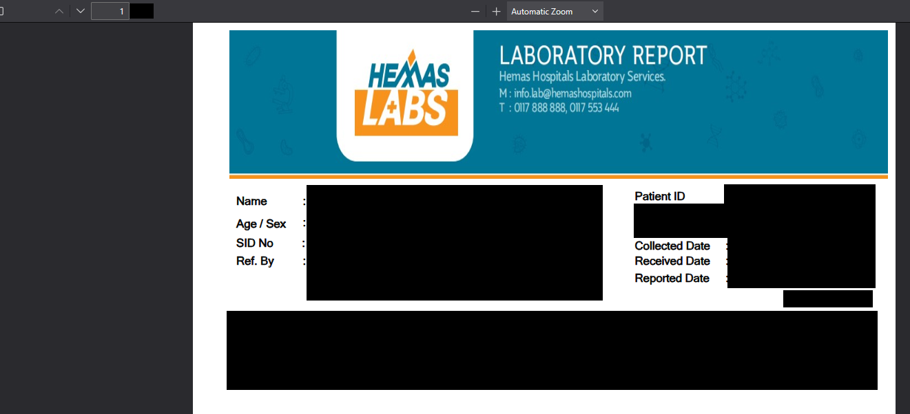
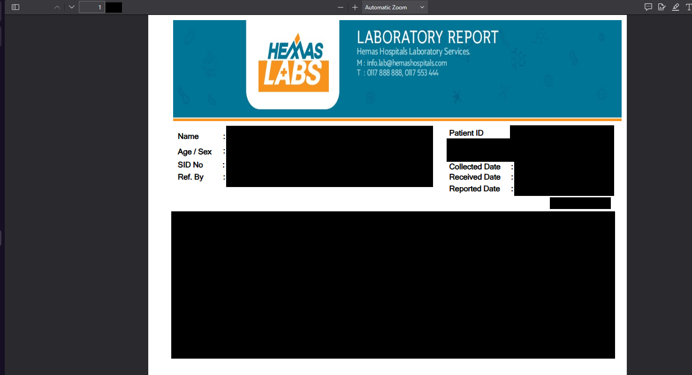
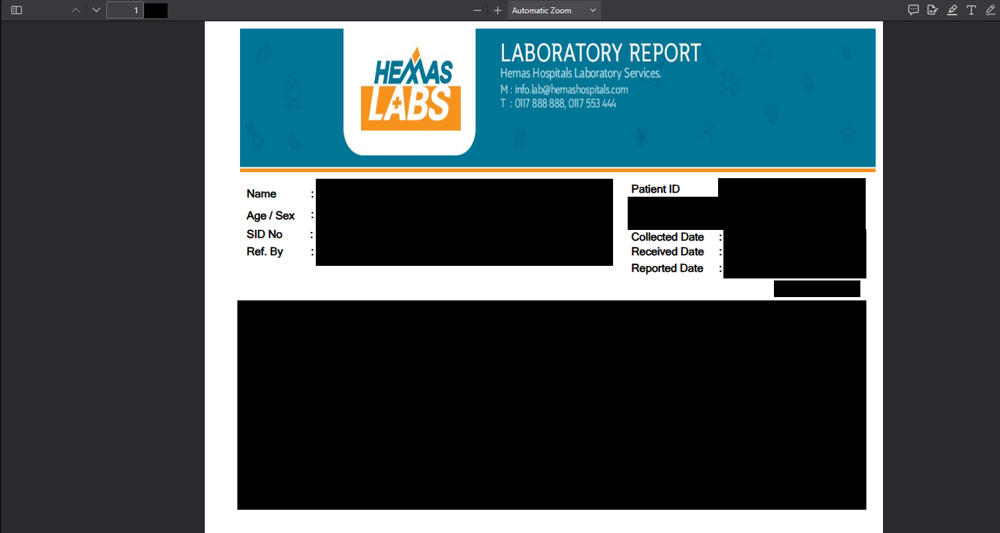

> **Update:** I reported this privately to Hemas on 18 November 2026. When I last checked, the access was blocked. As of 24 November 2026, I have not received a reply.

## It started with a URL

There is no clever hacking in this one. I just looked at a URL.

I received a link to a laboratory report from Hemas Hospitals' lab portal. The filename had a number and what looked like a date, and it seemed to follow a pattern.

So I got curious. I changed the date. Nothing.

Then I changed the number.

Another patient's medical report opened. I had not signed in.

I kept three screenshots as evidence, showing reports belonging to three different patients. Here are the other two:

All three are redacted, and I have left out the real filenames and links.

## What went wrong?

A report number tells the server *which* report I want. It does not prove that I am *allowed* to read it. The server should check that every time, and here it gave me the report anyway.

This is called an **insecure direct object reference (IDOR)**, a type of broken access control. It is one of the simplest web vulnerabilities to understand, and one of the easiest to miss.

I am not claiming that every report was reachable, and I cannot say whether anyone else found this.

## How vulnerable are these sites, really?

This is what bothered me. No special tool. No broken encryption. Just one number between a stranger and someone's private medical information.

A leaked password can be changed. A leaked diagnosis cannot.

I can only speak for the systems I have looked at. But after [a ride-hailing app](article.html?p=android-fare-estimation-trust-boundary) that trusted numbers sent by the phone, [a banking app](article.html?p=android-epassbook-reverse-engineering) with its keys inside the APK, and now a hospital portal, I keep seeing the same mistake in Sri Lanka: **trusting what the user can see or change.**

## Reporting it

I emailed Hemas Hospitals' data protection address, with redacted screenshots and no working report links. I asked them to restrict access, check permission on every report request, and review their logs.

When I last checked, the access was blocked, but nobody had replied to me or confirmed a fix. I do not know what changed on the server, or whether the affected patients will be told. For a hospital, that is not good enough.

> The scariest vulnerabilities are not always the clever ones. Sometimes you just haven't looked at the simple things. 👀
